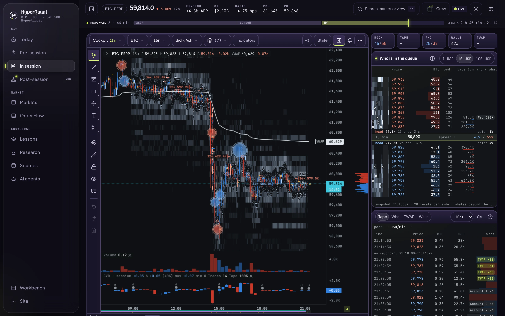
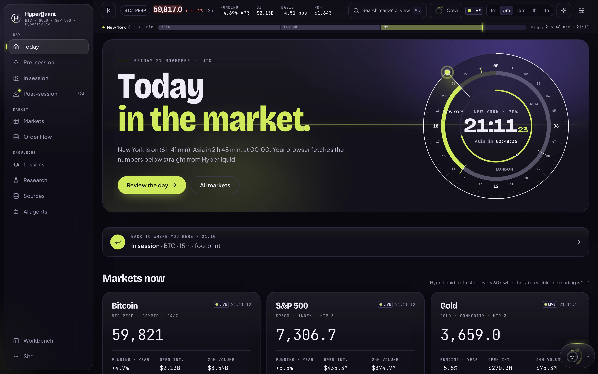
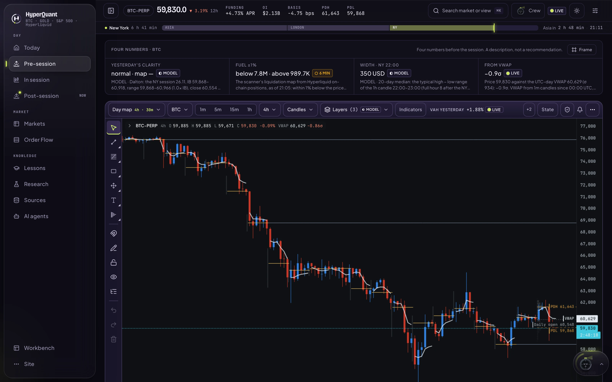
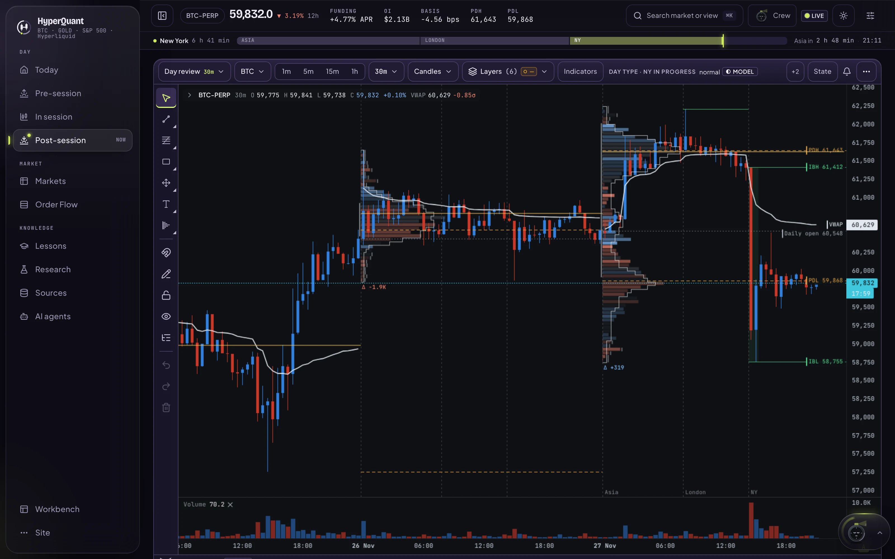
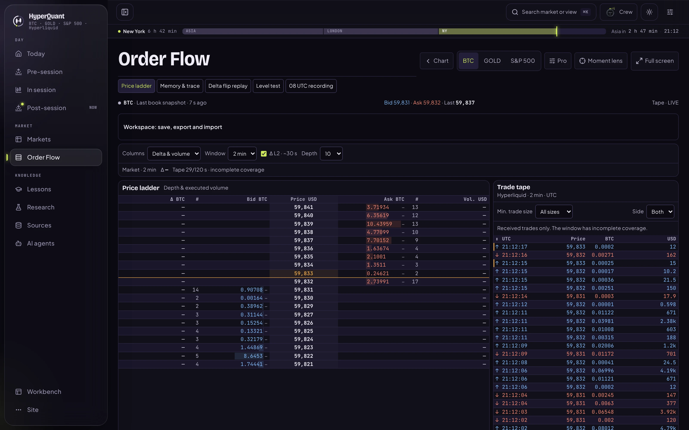
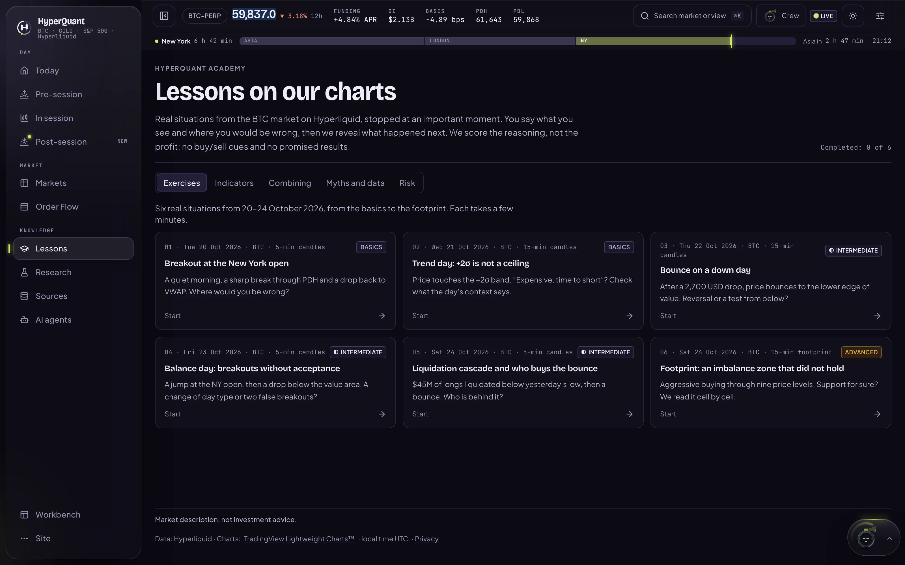
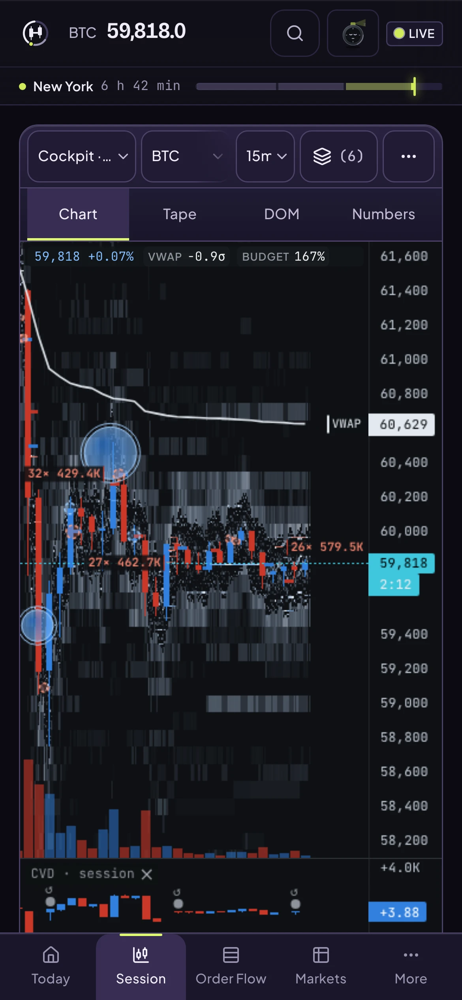
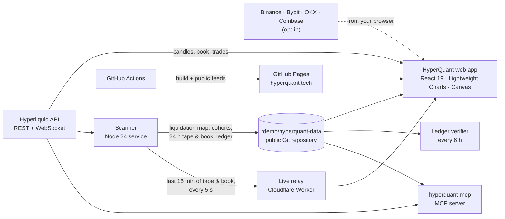

# HyperQuant — order-flow day-trading desk for BTC, gold and the S&P 500 on Hyperliquid

<div align="center">

[](https://github.com/rdemb/HyperQuant/actions/workflows/ci.yml)
[](https://github.com/rdemb/HyperQuant/actions/workflows/ledger-verify.yml)
[](LICENSE)
[](https://www.npmjs.com/package/hyperquant-mcp)
[](https://hyperquant.tech/)

</div>

<p align="center">
  <b>Open-source order-flow analytics for Hyperliquid perpetuals.</b><br>
  Footprint charts from the real trade tape, order-book heatmap, delta and CVD, liquidation maps from on-chain positions<br>
  and a forecast ledger that anyone can verify. A free, installable web app: no sign-up, no API keys, no buy/sell signals.
</p>

<p align="center">
  <a href="https://hyperquant.tech/"><b>Open the app</b></a> ·
  <a href="https://hyperquant.tech/en/charts/">Charts</a> ·
  <a href="https://hyperquant.tech/en/lessons/">Lessons</a> ·
  <a href="https://hyperquant.tech/en/results/">Forecast results</a> ·
  <a href="https://hyperquant.tech/blog/">Blog</a> ·
  <a href="mcp/README.md">MCP server</a> ·
  <a href="docs/FEATURES.md">Feature reference</a>
</p>



<p align="center"><sub>In session: BTC-PERP on Hyperliquid with the order-book heatmap, aggressor bubbles, maker walls, VWAP and CVD, next to the live DOM ladder and the tape. Real data, captured from the live app.</sub></p>

## Why HyperQuant

Hyperliquid is an on-chain exchange: every trade on its public tape carries the aggressor side and the addresses of both counterparties, and every position is readable on chain. HyperQuant turns that into the tools a futures day trader expects from a professional platform, and goes further where a centralised exchange cannot:

- **Order flow measured, not approximated.** Footprint, delta, CVD and "who is trading" are computed from the real tape, not inferred from candles.
- **Liquidations from positions, not guesses.** The liquidation map is built from the on-chain positions of tracked wallets, with coverage shown explicitly: for BTC, and for any other main-exchange market (ETH, SOL, HYPE and more) once the scanner sees at least 30% of its open interest from readings no older than 30 minutes.
- **Forecasts you can check.** Every 15 minutes the desk records its forecasts before the fact in a SHA-256 hash chain with OpenTimestamps receipts, and an independent verifier re-checks the whole ledger every 6 hours.
- **Free, no subscription, private.** A static site with no accounts and no paid tier. The architecture keeps the cost of one more user at zero: your browser reads Hyperliquid directly, shared data comes from public CDNs, and the scanner and live relay run once for everyone (the relay within Cloudflare's free plan). Your journal, drawings, alerts and settings stay in your browser.

## Principles

1. **Honest data.** Every value carries a tag: `LIVE` (real data), `MODEL` (model output from real data, method documented) or `SIM`. Missing data is shown as "—", never as a placeholder number.
2. **The desk describes the market; it does not suggest entries.** No automatic LONG/SHORT signals. Panels show measured facts, history with uncertainty, and models labelled as such.
3. **Public, legal data.** The core is Hyperliquid's public API. Centralised exchanges (Binance, Bybit, OKX, Coinbase) are strictly opt-in: your own browser makes the connection, for personal use, and it is off by default.
4. **Your data stays with you.** The trade journal, drawings, tabs and settings live only in your browser (localStorage and IndexedDB).
5. **One palette, „Głębia”.** Buy is azure `#3280DD` and sell is ember `#CA3829`, a pair that stays distinguishable for colour-blind readers ([style guide](docs/STYLEGUIDE.md)).

## Features

<table>
  <tr>
    <td width="50%"></td>
    <td width="50%"></td>
  </tr>
  <tr>
    <td><b>Today.</b> The trading day at a glance: a 24-hour session clock and live cards for every desk market (price, funding, open interest, 24 h volume).</td>
    <td><b>Pre-session.</b> Four numbers before the session, the day map, liquidation map with cascade simulation, US macro calendar and funding across venues.</td>
  </tr>
  <tr>
    <td></td>
    <td></td>
  </tr>
  <tr>
    <td><b>Post-session.</b> Day review with Market Profile, initial balance and day type, the session review, and a trade journal with per-setup statistics.</td>
    <td><b>Order Flow.</b> Price ladder with depth and executed volume, the live tape, delta-flip replay, level tests and the 08:00 UTC recording.</td>
  </tr>
</table>

### Charts (In session)

- **Same instrument, several venues**: stocks, indices and commodities listed by more than one HIP-3 deployer (NVDA, GOOGL, AAPL, MU and about 20 more today) side by side: mark price against the average, annual funding and open interest per venue, plus the price, oracle and funding gaps between them. Markets with the same name but a different price are kept apart.
- **Every Hyperliquid market**: all active perpetuals of the main exchange and every HIP-3 exchange (357 today) are searchable in the market picker and ⌘K and listed on the Markets page with open interest, volume and funding. BTC, gold and the S&P 500 stay the core markets with the full scanner; the rest get live candles, tape, book and footprint.
- **Footprint from the real tape**: Bid × Ask, Delta and Volume styles, POC, 70% value area, diagonal imbalances and stacked zones.
- **Order-book heatmap**, aggressor bubbles, bursts, maker walls, icebergs and large resting orders; whale positions under a pseudonym valid for one UTC day, never an address.
- **Delta and CVD** reset per Asia, London and New York session, UTC day or week; optional Binance and Bybit comparison.
- **Indicators**: daily and session VWAP with σ bands, visible-range and fixed-range volume profile, TPO day profile, initial balance with extensions, PDH/PDL, liquidation clusters.
- **Replay** of the last 24 hours of recorded tape and book at 1×, 5×, 15× or 60×, with links to a chosen moment.
- **Layouts by phase of the day**, 1/2/4-chart grids, TradingView-style drawing tools, and price alerts delivered by Web Push even with the page closed.
- **Order Flow liquidity heatmap**: the order book over the last 5, 15 or 60 minutes with best bid and ask lines and aggressor bubbles, filled from the server recording, above the price ladder and tape.
- **DOM & tape column**: who is in the queue, walls eaten or pulled, tape with memory (TWAP slices glued into one row), TWAPs en route, who absorbs the hits.

### Analytics and learning

- **Verifiable forecast ledger**: BTC 1 h and 4 h return quantiles from a seasonal log-HAR + FHS model, touch probabilities for key levels, CRPSS against a benchmark, and Brier/BSS against the distance baseline (a reflection formula) as well as the base rate. [Results](https://hyperquant.tech/en/results/).
- **Lessons**: six "What would you do?" exercises on real BTC days, an atlas of the chart indicators, and the Folklore lab, which tests popular day-trading rules with a pre-registered forward test.
- **Research**: Hyperliquid HIP-4 outcome markets against the desk model, order-book mechanics from the literature (OFI, Hawkes, microprice), VPIN, Kyle's λ, Hurst and regime detection.
- **AI agents**: [`hyperquant-mcp`](mcp/README.md), a read-only MCP server that gives Claude Desktop and other MCP clients the same BTC market context (`npx -y hyperquant-mcp@0.1.5`).

<p align="center"> </p>

The app installs like a native app (PWA) on desktop and mobile, and is available in English and Polish. After an update it opens a short *What's new* window with the changes you have not seen yet, built from the changelog. Every screen and panel is described in the **[feature reference](docs/FEATURES.md)**.

## Markets

<!-- rynki:start -->
| Market | Hyperliquid | Exchange | Oracle / underlying | Underlying hours | Data on the desk |
| --- | --- | --- | --- | --- | --- |
| Bitcoin | `BTC` | main | the BTC perpetual on Hyperliquid | none, 24/7 | candles, tape, book, liquidation map and tape, cohorts, trapped positions, forecast ledger, blog maps, exchange panels |
| Gold | `xyz:GOLD` | HIP-3 (trade.xyz) | spot gold XAU/USD | CME (metals): Sun 18:00 – Fri 17:00 ET, daily break 17:00–18:00 ET | candles, tape, book and the indicators built on them; outside the underlying hours the price is set by the platform |
| S&P 500 | `xyz:SP500` | HIP-3 (trade.xyz) | the S&P 500 index during NYSE hours, futures outside them | NYSE 09:30–16:00 ET (index), CME futures outside it | candles, tape, book and the indicators built on them; outside the underlying hours the price is set by the platform |
<!-- rynki:end -->

The list of markets lives in one file, `src/config/deskMarkets.ts`; `node scripts/markets/sync.mjs` writes it into this README, `index.html` and the app manifest, and CI fails when they differ.

## Quick start

Requires **Node.js 24** (the version CI and the scanner use). No API keys are needed.

```bash
git clone https://github.com/rdemb/HyperQuant.git
cd HyperQuant
npm ci --legacy-peer-deps
npm run dev            # Express + Vite at http://localhost:3000
```

The browser talks to Hyperliquid directly. Features built on the scanner (liquidation map, 24 h tape and book history, cohorts, whales, the ledger) read the public data repository; point the app at it with:

```bash
VITE_DATA_BASE_URL=https://raw.githubusercontent.com/rdemb/hyperquant-data/main npm run dev
```

| Script | What it does |
| --- | --- |
| `npm run lint` | type check (`tsc --noEmit`) |
| `npm test` | Vitest unit and integration tests |
| `npm run build` | production build to `dist/`, including the blog and static pages |
| `npm run data` | fetches public macro feeds into `public/data/feeds` |
| `npm run ui:check` | layout acceptance tests in headless Chrome on fixed data and a frozen clock |
| `npm run mcp:build` | bundles the MCP server |
| `node scripts/readme/shots.mjs` | regenerates the screenshots in `docs/media` from a build with `VITE_DATA_BASE_URL` |

**Your own copy on GitHub Pages:** fork → *Settings → Pages → Source: GitHub Actions*, and set the repository variable `DATA_BASE_URL` to the data repository URL above. The `static.yml` workflow tests, builds and publishes the site on every push to `main` and on a schedule.

## Architecture



- **Web app** (`src/`): React 19, TypeScript, Vite 8, Tailwind CSS 4, TradingView Lightweight Charts™ 5 and custom Canvas renderers for footprint, heatmap and DOM; Monte Carlo models run in a Web Worker.
- **Scanner** (`backend/`): a Node 24 service that tracks positions, liquidations, cohorts and the forecast ledger, records 24 h of tape and book, and publishes everything to a public Git repository. The browser never connects to the scanner. Details in [backend/README.md](backend/README.md) (Polish).
- **Live relay** (`workers/live/`): a Cloudflare Worker with a Durable Object that serves the last 15 minutes of the scanner's recording, so a freshly opened chart has no gap before its own live stream. The scanner sends every recorded market in one request every 5 s (about 17,000 requests a day, inside Cloudflare's free plan), and the data-health check raises an alert when the relay goes stale.
- **Hyperliquid node** (`backend/deploy/node/`, in preparation): an installer for a non-validator node (fills with both counterparties, liquidations of all accounts, an order-level book) and the record parsers the scanner will read from.
- **MCP server** (`mcp/`): read-only market context for AI assistants, published on npm.
- **Static site and blog** (`scripts/blog/`, `content/blog/`): pre-rendered landing pages, lessons, the indicator atlas, the results page, RSS and sitemap.

```
src/
  charts/      Charts view: Hyperliquid client, tape and footprint store, chart controller, drawing tools, venues
  views/       screens: Today, Pre-session, In session, Post-session, Order Flow, Markets, Lessons, Research, Sources
  utils/       quant engines: volatility model, ledger, liquidation map, auction context, microstructure
  state/       data feed (REST + WebSocket), contexts, routing
  lessons/     exercises, market slices, lesson figures
  shell/       app shell, PWA (install, updates, offline)
backend/       scanner: positions, liquidations, cohorts, ledger, tape and book recorder
mcp/           hyperquant-mcp server
scripts/       data fetching, ledger verifier, blog and static pages, UI checks, screenshots
docs/          feature reference, methods, style guide, blog format
```

## Methods

The numbers follow published methods, each cited in the code and in the app's data-lineage table. A summary:

- **Buy/sell split**: the real aggressor side from Hyperliquid's WebSocket; for older candles Bulk Volume Classification (Easley, López de Prado & O'Hara 2012), labelled `MODEL`.
- **Volatility**: seasonal log-HAR (Corsi 2009) on hourly Garman–Klass variances with an intraday profile (Andersen & Bollerslev 1997), scored live out of sample with QLIKE (Patton 2011).
- **Barrier probabilities**: Monte Carlo with filtered historical simulation (Barone-Adesi et al. 1999) and a discrete-monitoring correction (Broadie, Glasserman & Kou 1997).
- **Liquidation cascade**: the square-root impact law (Tóth et al. 2011) as an upper bound, and a Monte Carlo on the measured order book.
- **Forecast scoring**: CRPSS, PIT, Kupiec coverage, adaptive conformal inference (Gibbs & Candès 2021), Brier/BSS against the distance baseline and the base rate, Venn–Abers calibration.
- **Folklore lab**: exact martingale baselines from the optional stopping theorem, Benjamini–Hochberg on history, and e-values (Waudby-Smith & Ramdas 2023; e-BH, Wang & Ramdas 2022) for a forward test that stays valid under continuous monitoring.

The full description, with every estimator and reference, is in **[docs/METHODS.md](docs/METHODS.md)**.

## Verify the forecast ledger

Every forecast is written before the fact to a hash chain on the [`ledger`](https://github.com/rdemb/hyperquant-data/tree/ledger) branch of the data repository, with OpenTimestamps receipts anchored in Bitcoin. The app verifies the chain in your browser with one click; for a full independent check:

```bash
git clone --branch ledger https://github.com/rdemb/hyperquant-data.git ledger
node scripts/verify-ledger.mjs --dir ledger --market --bitcoin
```

The verifier checks the chain, git history, ordering and receipts, recomputes the scores from the recorded quantiles, refits the ensemble weights and compares settlement prices with Hyperliquid candles. The same check runs in GitHub Actions every 6 hours (badge above). The ledger data is licensed under [CC BY 4.0](https://creativecommons.org/licenses/by/4.0/).

## Data sources

| Source | What | Notes |
|---|---|---|
| Hyperliquid API (`/info`, WebSocket) | candles, L2 book, trades, OI, funding (also Binance/Bybit via `predictedFundings`), HIP-3, market map | public, limit of 1200 weight/min per user IP |
| HyperQuant scanner ([backend/](backend/README.md)) | liquidation map from on-chain positions (`clearinghouseState` of wallets seen on the BTC tape; other main-exchange markets from the same readings when coverage and freshness pass the bar, listed in `status.json`), realised liquidation tape (confirmed by fills with the `liquidation` field), cohort flow from the tape (`users` field + aggressor side), the last 24 h of tape and order book for the Charts view, closed-day price profiles (buy, sell and open-interest change per price, 7 days) and the whale layer (pseudonyms only); no addresses | published to the public repository [rdemb/hyperquant-data](https://github.com/rdemb/hyperquant-data) (main files every 2 min, tape history in 5-minute parts, the last 15 minutes through the live relay every 5 s); the browser never connects to the scanner's server |
| Federal Reserve, BLS, BEA | FOMC, CPI, NFP, PPI, GDP/PCE schedule | US public data |
| U.S. Treasury, FiscalData, NY Fed, CFTC | yields, TGA, RRP, COT | US public data |
| alternative.me | Fear & Greed | attribution next to the data |
| GDELT Project | media tone | citation + link |
| mempool.space | fees, difficulty, hashrate | — |
| RSS (CoinDesk, Cointelegraph, Decrypt, The Block, Bitcoin Magazine, Fed, BLS, SEC) | headlines | title, time and link to the publisher only |
| Binance, Bybit, OKX, Coinbase | trades and liquidations; on the Charts screens also delta, open interest and funding | **opt-in only**, in the user's browser |

Public data from outside Hyperliquid is fetched by a GitHub Actions workflow (`scripts/fetch-public-data.mjs`, no API keys) and published with the site as `data/feeds/*.json`.

## Limitations

- Hyperliquid's public API has no trade or order-book history. The Charts view loads the last 24 hours recorded by the scanner and keeps its own tape in the browser; time covered by neither stays a visible gap, never an estimate.
- HIP-3 markets are proxy perpetuals, not cash indices; outside the underlying's hours the price is set by the platform.
- Models (Monte Carlo, OU, VPIN, Hurst) are descriptive tools; their accuracy is measured live in the forecast ledger. More in [docs/METHODS.md](docs/METHODS.md#limitations).

## Contributing

Contributions are welcome. The simplest way to support the project is to star the repository and share it with other traders: it helps people find free tools. Read the [contributing guide](CONTRIBUTING.md) (content rules, conventions, PR checklist) and the [code of conduct](CODE_OF_CONDUCT.md). Report vulnerabilities privately as described in [SECURITY.md](SECURITY.md). The changelog is kept in Polish in [CHANGELOG.md](CHANGELOG.md).

## License

Code: [MIT](LICENSE). Forecast ledger data: [CC BY 4.0](https://creativecommons.org/licenses/by/4.0/). Charts are built on [TradingView Lightweight Charts™](https://www.tradingview.com/lightweight-charts/) (Apache 2.0, see [NOTICE](NOTICE)).

## Disclaimer

HyperQuant is an educational and analytical tool. It is not investment, financial or legal advice and does not generate trading signals. Trading leveraged contracts carries a high risk of losing capital.
